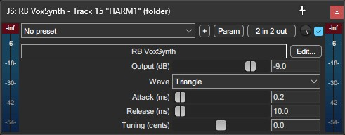

# RB VoxSynth

A JSFX Synth for previewing RB style vocal charts in REAPER. Made for previewing vocal notes with slide support.

## Requirements

- REAPER with ReaScript support enabled.
- MiloHax's RB Charting Template (or similar with PART VOCALS and HARM1/2/3 tracks).

## Installation
1. Download .zip from the **Releases** tab
2. Copy **RB VoxSynth (background).lua** to **%appdata%/REAPER/Scripts**
3. Copy **RB VoxSynth** (JSFX without extension) file to **%appdata%/REAPER/Effects**
4. In REAPER, go to Actions > Show action list...
5. Click New action... and then Load ReaScript  
	5.1 Navigate to **%appdata%/REAPER/Scripts**  
	5.2. Select **RB VoxSynth (background).lua** and click **Open**  
	5.3. Optionally, add a keybind, or use the Menu Editor to add the action to a toolbar
## Running the script
First of all, make sure you have followed the installation steps correctly.
- If you kept REAPER open while installing the files, you'll just need to update your plugin database (go to any track and open the Add FX window, then hit **F5**)  

Run **RB VoxSynth (background).lua**. The ReaScript will search for the **PART VOCALS** and **HARM1/2/3** tracks and add the JSFX into each track.  

- You can also put the JSFX first on the vocal/harm tracks and the script will attach to them automatically.
## Troubleshooting

- If you notice your changes to a MIDI track are not being reflected in the synth, you may have accidentally stopped the **.lua** script. Just run it again and it'll be working just fine.

